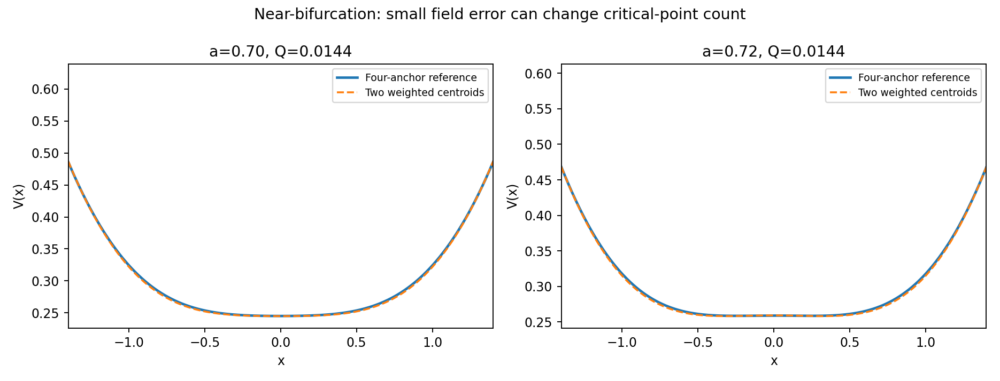
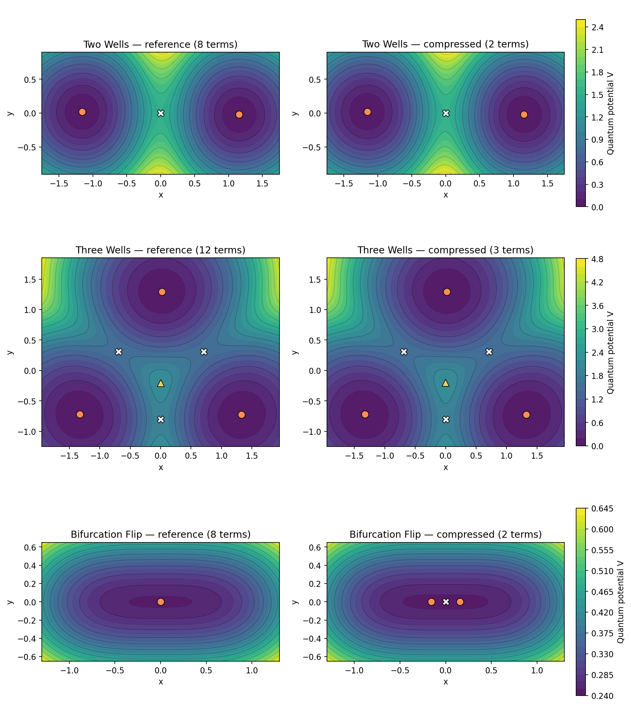
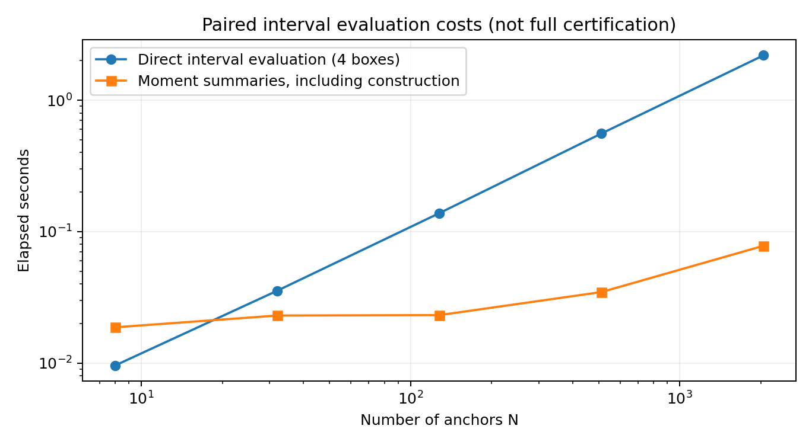
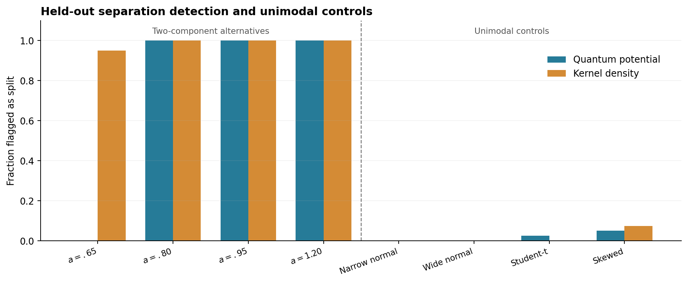

# Certified Compression of Gaussian Quantum-Potential Landscapes

**Stability bounds, critical-point counterexamples, computational tradeoffs, and matched KDE comparisons**  

**Domenic Merenda**  
[dmerenda@gmail.com](mailto:dmerenda@gmail.com)  
22 November 2026

[Read the complete report](report/Quantum_Potential_Landscape_Study.md) · [PDF with illustrations](docs/assets/Quantum_Potential_Landscape_Study.pdf) · [One-page illustrated website](docs/index.html) · [Reproduction instructions](REPRODUCE.md)

This repository examines whether weighted landmark and moment-based approximations of a [Quantum Clustering](https://en.wikipedia.org/wiki/Quantum_clustering) (QC) potential can preserve the structure of its [critical points](https://en.wikipedia.org/wiki/Critical_point_(mathematics)), reduce verification cost, and improve downstream statistical detection. The outcome is **mixed**: compressed verification works well for tightly concentrated mixtures, but certificates become inconclusive for difficult geometries and a matched held-out test did not show an advantage over bandwidth-tuned Gaussian [kernel density estimation](https://en.wikipedia.org/wiki/Kernel_density_estimation) (KDE).

> **Scope.** This study concerns *static Gaussian quantum-potential clustering*, not unitary Dynamic Quantum Clustering or quantum computing. A numerical root-count match is not a formal topology certificate.

## Main findings

| Question | Observed result |
|:--|:--|
| Can weighted group summaries support critical-point verification? | Yes, on tested compact two-well examples. |
| Do small potential errors always preserve critical-point counts? | No; the near-[bifurcation](https://en.wikipedia.org/wiki/Bifurcation_theory) counterexample changes the topology. |
| Do compression benefits generalize to difficult geometry? | Not established; overlap, anisotropy and near-degeneracy produced inconclusive certificates. |
| Is the method consistently faster end-to-end? | Not established; the paired 32-anchor test was 17.945 s direct vs. 16.238 s compressed. |
| Does QC outperform tuned KDE on the held-out split benchmark? | No; KDE detected 98.75% vs. QC 75.0%, at the same 1.875% false-split rate. |

## Figures

### Critical-point stability and failure

*Figure: A small discrepancy between two potentials can change the number of critical points close to degeneracy.*

### Two-dimensional potential landscapes

*Figure: Exact and compressed landscapes, marking minima, saddles and maxima. These comparisons do not certify full basin connectivity.*

### Computation and compression

*Figure: Cost of interval-box evaluation and summary construction; **not** an end-to-end certification speedup.*

### Matched QC versus KDE comparison

*Figure: Held-out synthetic two-component split detection, with bandwidths separately selected on validation data.*

**More visualizations:** [near-bifurcation 2D example](docs/assets/figures/figure_09_two_dimensional_bifurcation.png) · [QC versus KDE geometry](docs/assets/figures/figure_03_qc_kde_geometry.png) · [dispersion sensitivity](docs/assets/figures/figure_05_dispersion_sensitivity.png) · [potential example](docs/assets/figures/figure_06_earlier_potential_example.png) · [approximation progress](docs/assets/figures/figure_07_approximation_progress.png).

## Read and reproduce

The [complete report](report/Quantum_Potential_Landscape_Study.md) includes the model, derivative-error bound, counterexamples, [interval-arithmetic](https://en.wikipedia.org/wiki/Interval_arithmetic) verification, computational benchmarks, limitations, primary references, and additional images.

The [PDF](docs/assets/Quantum_Potential_Landscape_Study.pdf) contains the typeset report. Scripts are in [`code/`](code/), original experimental tables in [`data/`](data/), and instructions in [REPRODUCE.md](REPRODUCE.md).

## tl;dr

Moment-compressed Gaussian fields can support critical-point verification in favorable regimes. The present work does not demonstrate a QC-specific new learning theorem, a general algorithmic advantage over strong kernel methods, or full [Morse–Smale](https://en.wikipedia.org/wiki/Morse%E2%80%93Smale_system) topology preservation. The examples and failure cases are retained for reproducibility and future reference.
