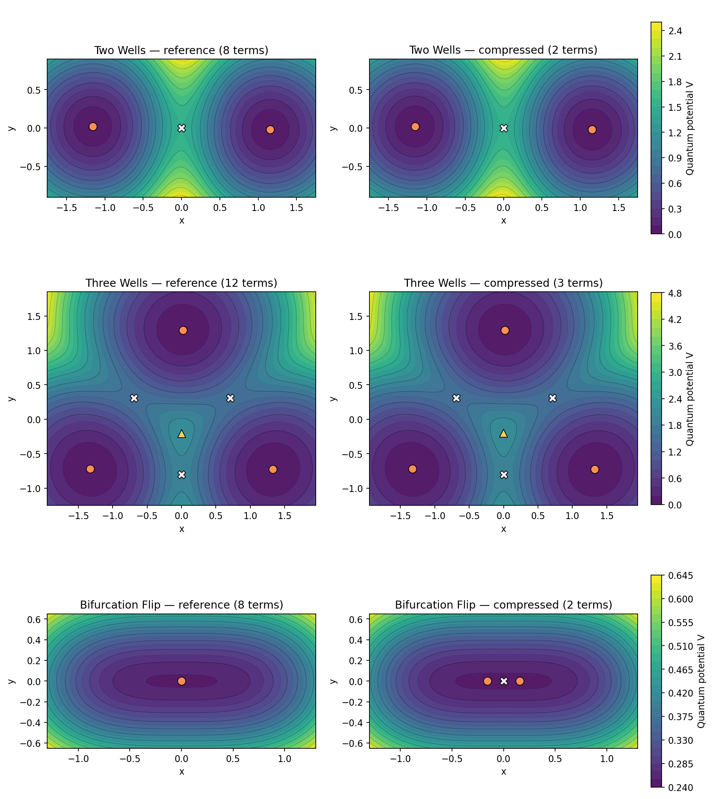
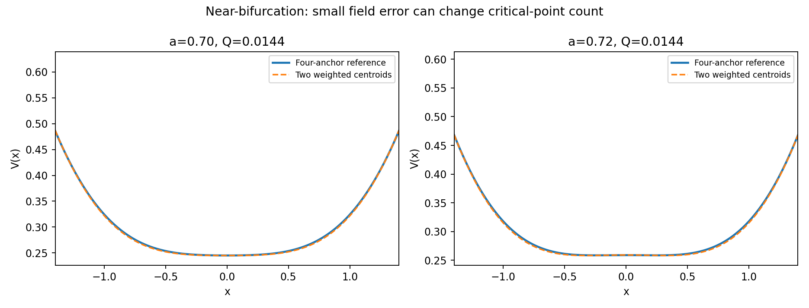
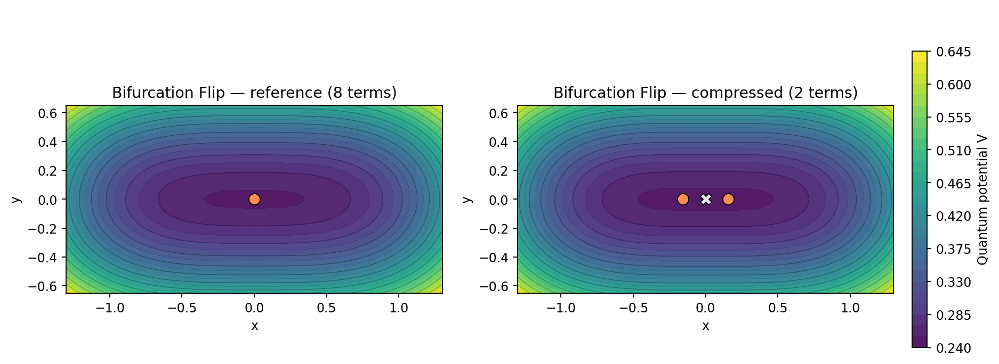
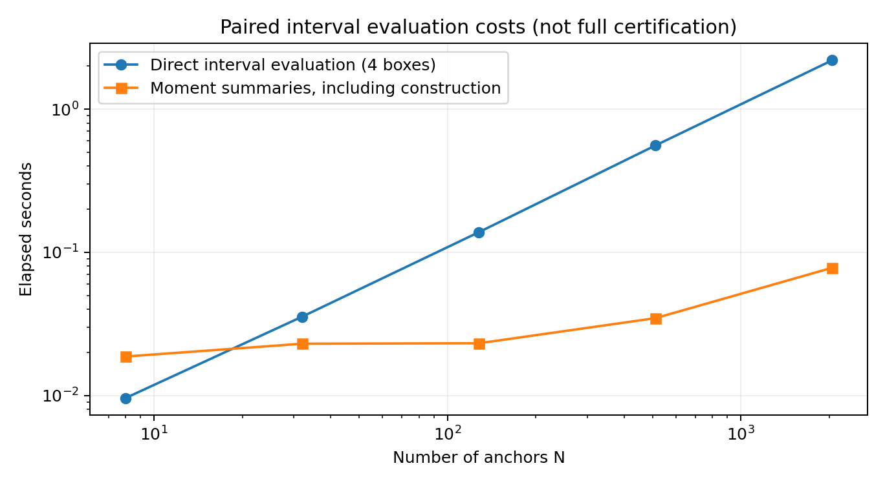
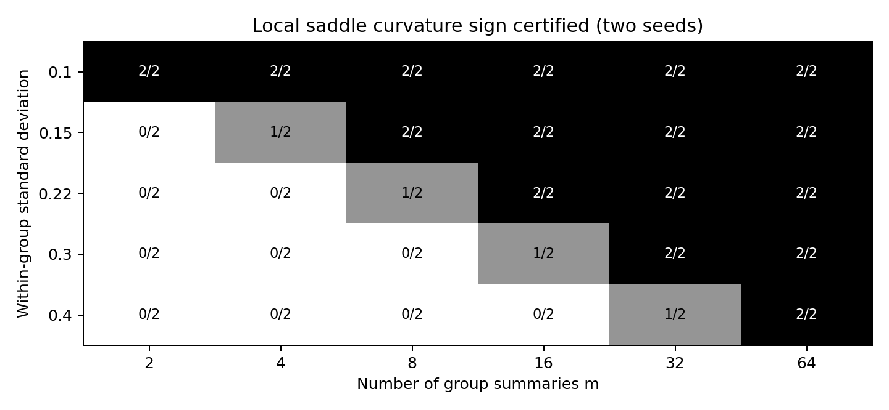
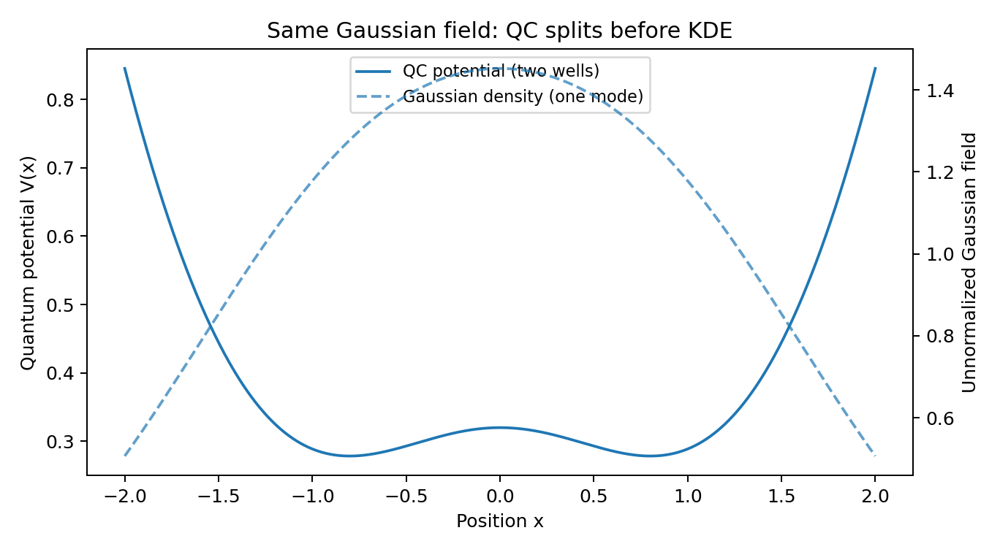
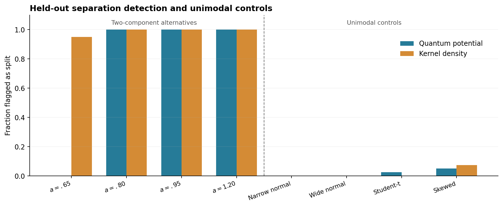

# Certified Compression of Gaussian Quantum-Potential Landscapes

*Stability bounds, critical-point counterexamples, computational tradeoffs, and matched KDE comparisons*

**Domenic Merenda**  
[dmerenda@gmail.com](mailto:dmerenda@gmail.com)  
22 November 2026

## Abstract

**Question.** Can low-cardinality summaries of Gaussian quantum-clustering potentials preserve and certify critical-point structure at lower computational cost, and does the extra potential topology provide downstream statistical value?

**Approach.** We derive group-moment Taylor enclosures, couple them to interval/Krawczyk critical-point tests, examine near-bifurcation failures, benchmark full and compressed verification, and compare quantum-potential separation detection with bandwidth-tuned kernel density estimation (KDE).

**Results.** Small two-dimensional reference potentials can be verified from compressed summaries. On a favorable fixed two-well family, two summaries supported verification through 2,048 original anchors with approximately constant observed verification time. Certification was inconclusive on overlapping, anisotropic and near-degenerate inputs, however, and paired 32-anchor end-to-end time improved only modestly (17.945 s direct; 16.238 s compressed). In a held-out synthetic split-detection study, tuned KDE detected 98.75% of alternatives versus 75.0% for QC at a shared 1.875% false-split rate.

**Conclusion.** The results support an instructive numerical technique and useful counterexamples; they do not establish a general new topology-preserving coreset theorem, consistent computational superiority, or a unique machine-learning advantage.

## 1. Research question and scope

Quantum Clustering (QC) constructs a scalar potential from a Gaussian
kernel field. Critical points of this potential can reveal structure not
shared by the modes of the original Gaussian density estimator. The
research considered whether compressing the Gaussian sources into
weighted groups---and retaining enough moment or support
information---could preserve this structure with certifiable error and
worthwhile computation savings.

This work concerns *static Gaussian QC*, not time-dependent unitary
Dynamic Quantum Clustering, quantum computing, or a general-purpose
classifier. We distinguish: (a) a numerical root match, (b) a
conditional interval certificate of the count and types of critical
points on a domain, and (c) full basin topology, which the current
method does not certify.

For locations $x_i\in\mathbb R^d$, positive weights $w_i$ and bandwidth
$\sigma>0$, define $$\begin{aligned}
\psi(x)&=\sum_iw_i\exp\!\left(-\frac{\|x-x_i\|^2}{2\sigma^2}\right),\\
V(x)&=\frac{\sigma^2}{2}\frac{\Delta\psi(x)}{\psi(x)}+\frac d2
=\frac{\sum_iw_i\exp(-\|x-x_i\|^2/(2\sigma^2))\|x-x_i\|^2}{2\sigma^2\sum_iw_i\exp(-\|x-x_i\|^2/(2\sigma^2))}.
\end{aligned}$$ The second equality holds exactly for isotropic Gaussian
kernels. The potential is a location-dependent, kernel-weighted mean
squared distance, not a simulated quantum trajectory. All topological
assertions are restricted to explicit compact analysis domains.

## 2. Compression and verification method

### Why group moments improve an approximation

Group the sources into sets $G_j$ with centers $c_j$, residuals
$r_i=x_i-c_j$, and moment sums $S_j=\sum_{i\in G_j}r_i$ and
$M_j=\sum_{i\in G_j}r_ir_i^\top$. For a Gaussian kernel $K$, a
multivariate Taylor expansion gives $$\sum_{i\in G_j} D^\alpha K(x-x_i)
=n_jD^\alpha K(x-c_j)-S_j\!\cdot\!\nabla D^\alpha K(x-c_j)
+\tfrac12M_j\!:\!\nabla^2D^\alpha K(x-c_j)+R_{j,\alpha}(x).$$
Exact centroid choice cancels $S_j$. Storing the second moment corrects
the next term; support-based third-order remainders bound the residual.
Derivatives of $V$ through its Hessian require Gaussian-field
derivatives through fourth order; the remainder enclosures therefore
evaluate Gaussian derivatives through seventh order. Bounds must also
establish $\psi>0$ over every queried spatial box before dividing.

### Conditional critical-point certification

The verifier proposes roots of $\nabla V=0$, then uses interval
gradient/Hessian enclosures and Krawczyk tests to establish existence
and uniqueness within candidate boxes. Interval subdivision excludes
additional roots from the remaining rectangular domain. The Hessian's
inertia distinguishes minima, saddles and maxima. When subdivision
cannot settle all regions, the result is **inconclusive**, not a proof
of a topological mismatch.

*Figure 1. Two-dimensional reference and compressed potentials: two-well and three-well cases with matched critical-point counts. Markers indicate critical-point types. These are critical-point certificates, not full basin-connectivity certificates.*

## 3. A counterexample and the role of degeneracy

Near a bifurcation, two pointwise-close potentials need not have the
same number of wells. A controlled one-dimensional four-anchor reference
had a single minimum while its two-centroid representation had two
minima and one maximum. The quantization error was $Q=0.0144$ and
sampled maximum potential difference $0.01176$, yet the central
curvature changed sign ($+0.00638$ versus $-0.00820$). The qualitative
change is explained by proximity to a degenerate critical point;
numerical smallness alone is insufficient for topological stability.

*Figure 2. Near-bifurcation reference and two-centroid potential. Nearly overlapping curves can conceal different local critical-point structures. Original numerical plot; the counts were separately investigated through interval checks.*

*Figure 3. Two-dimensional adversarial example: a single reference minimum becomes two minima separated by a saddle after centroid approximation. Critical-point counts were checked on the specified bounded domain; global basin topology was not certified.*

A second exact construction illustrates why a centroid and covariance
cannot identify the QC topology. With $\sigma=1$, the symmetric weighted
samples $\{-0.8,+0.8\}$ with weights $(.5,.5)$ and $\{-1.6,0,+1.6\}$
with weights $(.125,.75,.125)$ both have mass one, mean zero and
variance $0.64$. Yet $V''(0)=-0.28$ for the first and approximately
$+0.8201$ for the second. Their central stationary points have opposite
local type. A certification scheme relying only on raw moments without
support/remainder information cannot resolve this distinction in
general.

## 4. Certification results and computational costs

### Favorable compact two-well distributions

For a compact two-well family with fixed group complexity, two moment
summaries supported successful conditional verification of two minima
and one saddle as the number of original anchors grew. Observed
verification time including summary construction was approximately
13--14 s for $N\in\{8,32,128,512,2048\}$. This does *not* establish
constant-time complexity for arbitrary data: group spread and the number
of resolved structures were held approximately fixed.

| Original sources N | Moment summaries m | Verification time (s) |
|---:|---:|---:|
| 8 | 2 | 13.5 |
| 32 | 2 | 13.7 |
| 128 | 2 | 13.1 |
| 512 | 2 | 13.5 |
| 2,048 | 2 | 13.1 |

*Table 1. Single-run controlled two-well verification, including summary construction. These timings are not statistically characterized wall-clock estimates.*

*Figure 4. Direct versus moment-summary *interval-box evaluation*, including summary construction. This timing test measured four evaluation boxes, not complete root certification. It shows a strong primitive-level computational crossover, which must not be reported as an equivalent whole-verifier speedup.*

### Matched whole-verifier comparisons and failure cases

A fresh paired 32-anchor test certified the same three critical points:
17.945 s direct versus 16.238 s with moments, an approximately
1.11$\times$ speedup. A larger direct test was censored by a run limit
and is not a measured speedup. On deliberately overlapping, anisotropic
and near-degenerate mixtures, the moment verifier returned inconclusive
results or reached run limits even with more representatives. One direct
near-bifurcation run certified a single minimum in 3.403 s while the
moment verifier remained inconclusive.

| Stress case | N | m | Moment certificate outcome |
|---|---:|---:|---|
| Compact stochastic two-well | 32 | 2 | Three critical points certified |
| Overlapping two-well | 24 | 2, 4, 8 | Inconclusive at all three settings |
| Near-bifurcation | 24 | 2 | Inconclusive; one candidate region |
| Anisotropic three-group | 24 | 4 | Inconclusive; multiple candidates |
| Canonical three-well | 12 | 3 | Unfinished within imposed run limit |

*Table 2. Adversarial whole-verifier tests. Inconclusive does not demonstrate a topology change; cases were selected to stress the method.*

*Figure 5. Local saddle-curvature sign checks over group spread and landmark count. Dark cells indicate two seeds certified; light cells indicate inconclusive tests. These are local curvature checks, *not* global critical-point certificates.*

## 5. Does quantum-potential topology add statistical value?

For two equally weighted Gaussian sources at $\pm a$, the central KDE
density bifurcation occurs at $a=\sigma$, while the corresponding QC
potential changes central curvature at $a=\sigma/\sqrt2$. Thus QC can
yield two wells while same-bandwidth KDE remains unimodal. This is a
real analytic distinction, but a smaller KDE bandwidth can also produce
a split.

*Figure 6. The same Gaussian field can yield two QC potential wells while the density remains unimodal. The example illustrates sensitivity, not evidence of superior detection accuracy.*

We conducted a held-out test with 160 samples per dataset, four mixture
alternatives, four unimodal controls, a common nine-value bandwidth
candidate set and disjoint validation/test seeds. Each method chose its
bandwidth to maximize validation detection subject to pooled validation
false-split rate at most 5%. The final test evaluated 40 independent
seeds per condition; a split was registered by a numerical grid-mode
procedure. The selected bandwidths were $0.90$ (QC) and $0.52$ (KDE).

| Held-out metric | QC | KDE |
|---|---:|---:|
| Alternative detection (160 trials) | 75.0% | 98.75% |
| Control false-split rate (160 trials) | 1.875% | 1.875% |
| Closest mixture, a = 0.65 (40 trials) | 0/40 | 38/40 |
| Remaining three mixtures (120 trials) | 120/120 | 120/120 |

*Table 3. Bandwidths were selected on validation data and evaluated on disjoint test seeds. These synthetic results are not a universal method ranking.*

*Figure 7. Held-out separation detection by condition. The first four are two-component alternatives; the last four are unimodal controls. KDE's advantage is concentrated in the closest mixture. Raw seed-level outcomes are supplied in the repository data.*

The result fails to support a distinctive statistical advantage for QC
in this test. It does not establish an equivalence between the two
operators or rule out favorable problems elsewhere. Earlier nonconvex
clustering experiments also showed that strong spectral/density
baselines often matched QC's downstream bandit benefit, limiting the
significance of comparisons against K-means alone.

## 6. Independent audit, prior work, and what remains unproved

An independent high-precision implementation, using system MPFR at
256-bit precision and a different weighted-distance derivative formula,
checked sampled values of $V$, its gradient and its Hessian against
interval enclosures. All **72 of 72 sampled spatial boxes** passed, with
two sample points checked per box. These tests increase confidence in
the code, but do *not* independently validate every outward-rounded
interval operation or prove exhaustive root enumeration. No independent
formal proof assistant or separately audited interval arithmetic package
was used.

The approach overlaps heavily with established Gaussian kernel
approximation, Taylor moment methods, Krawczyk verification,
Morse-theoretic stability and topology-preserving KDE coresets. Related
prior art includes original Quantum Clustering by Horn and Gottlieb,
weighted-particle QC analyses, and recent uncertainty-aware KDE
Morse-core-set work. We did not implement the complete recent competing
topological coreset algorithm, so a claim of superiority to it would be
unsupported.

## 7. Conclusion

The investigation produced a reproducible technique for conditional
two-dimensional critical-point verification from compressed Gaussian
summaries, together with exact and numerical counterexamples clarifying
its limits. On compact structured mixtures, verification queries can
avoid revisiting all source observations, and primitive-level
computational costs can improve substantially. But hard distributions
frequently make certificates inconclusive; matched end-to-end speedup
was small in the completed paired test; and QC offered no distinctive
held-out resolution benefit over tuned KDE in the tested protocol.

**Reproduction note.** The accompanying repository contains source code, CSV
results, figure images, environment guidance and caveats. All plots
denote sampled or numerical observations unless explicitly marked as
interval-conditional.

## Reproducibility and artifact index

| Directory | Contents |
|---|---|
| `docs/assets/figures/` | Nine figure files, including the two-dimensional adversarial example |
| `data/` | CSV tables for detection, compression cost, dispersion, and independent checks |
| `code/` | Interval verifier, moment approximation, point audit, and held-out test code |

**Minimal replay commands** (run from the package root in a fresh Python
environment):

    python code/heldout_resolution.py
    python code/mpfr_point_audit.py
    python code/paired_certification.py \
      --case compact_big --n 32 --m 2 \
      --method moment --out compact_moment.json

The same verifier supports `--method direct` for comparison. Results
depend on runtime, dependencies and numerical precision. A failed or
timed-out certificate should be recorded as inconclusive; neither
constitutes a proof of differing topology.

## Selected references 

1.  Horn, D. and Gottlieb, A. (2001). *The Method of Quantum
    Clustering*. Advances in Neural Information Processing Systems.

2.  Maignan, A. and Scott, A. (2021). *A Comprehensive Analysis of
    Quantum Clustering: Finding All the Potential Minima*.

3.  Cohen-Steiner, D., Edelsbrunner, H. and Harer, J. (2007). Stability
    of persistence diagrams. *Discrete & Computational Geometry*.

4.  Chen, Y.-C., Genovese, C. and Wasserman, L. Statistical work on
    Morse-Smale complex estimation and stability.

5.  Lyu, G., Gorski, K., Phillips, J. and Wang, B. (2026). *A
    Topology-Preserving Coreset for Kernel Regression in Scientific
    Visualization*. IEEE TVCG.

6.  Lyu, G., Phillips, J. and Wang, B. (2026). *Topological Analysis of
    Kernel Density Estimates via Uncertainty-Aware Morse Complexes and
    Coresets*. IEEE VIS.
